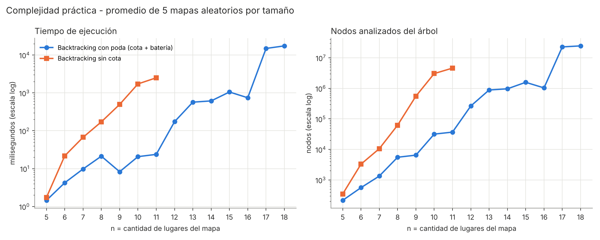

# TPO Programación III – La misión de Uada

Grupo: Valentín Umbides Álvarez y compañeros · Actualizado: 5 de noviembre de 2026 · Punteo para el grupo: [PUNTEO.md](PUNTEO.md)

La ruta más rápida del mapa de ejemplo tarda **4440 s (74 min)**: A348 \> PASILLO3 \> A201 \> BIBLIO \> LIMA3 \> STARBUCKS \> PATIO \> ASCENSOR \> A613 \> A633 \> ESCALERA \> A348, y llega con 0,40 de batería. El backtracking con poda la confirma explorando 1.419.140 nodos, contra 3.773.393 sin la cota. En el mapa de la cátedra (`mapa_grande.txt`) las 3 mejores rutas tardan **411 s**: Uada espera 1 s a que abra el Molinete Lima 3.

> **Técnica utilizada.** Según la indicación de la cátedra, la solución usa **solo backtracking con branch & bound**: no usa ningún otro algoritmo (ni Floyd, ni Dijkstra, ni programación dinámica). Las cotas se calculan directamente sobre el grafo.
>
> **Aviso sobre las fuentes.** El backtracking sigue el esquema de las clases 6a–6d de la materia (árbol de alternativas, estado como lista ordenada (X1, …, Xn), poda de las ramas que no llevan a una solución; N reinas, suma de subconjuntos y partición en mitades). La introducción del curso lista *Branch & Bound (Ramificación y Poda)* como tema y la guía de backtracking lo pide como variante ("aplique ramificación y poda"), pero **no hay una clase con el detalle de cómo calcular la cota**. Lo marcamos con ⚠ donde aparece.

## Supuestos e interpretación del enunciado

El enunciado no trae el mapa, así que el grupo lo define (sección siguiente). Los puntos ambiguos se resolvieron así:

| Punto del enunciado                                | Interpretación adoptada                                                                                                                                                                                                   |
|----------------------------------------------------|---------------------------------------------------------------------------------------------------------------------------------------------------------------------------------------------------------------------------|
| "Si la batería llega a 0 y no alcanzó el aula 633" | Confirmado por la profesora: es un error de tipeo y se refiere al **aula 348** (el destino final, según el resto del texto).                                                                                              |
| Batería "nunca llegue a 0 antes del destino"       | Tras cada movimiento debe quedar **\> 0**; al llegar a A348 al final se acepta **≥ 0**.                                                                                                                                   |
| Consumo al caminar                                 | 1 punto por minuto de mapa: segundos / 60.                                                                                                                                                                                |
| Saltando: "2,2 veces mayor que al caminar"         | Se compara con caminar **la misma conexión**: tiempo s/2, consumo 2,2 × s/60.                                                                                                                                             |
| Patas para arriba: "55% menor"                     | Tiempo 2s, consumo 0,45 × s/60.                                                                                                                                                                                           |
| Recarga en aulas                                   | (suma de dígitos)/5 al llegar, sin tiempo; tope de **100** (la batería inicial; confirmado). A348 no recarga al cerrar el circuito.                                                                                       |
| Pasar una única vez por cada lugar                 | Ningún lugar se repite; la única excepción es volver a A348 para terminar.                                                                                                                                                |
| Ventana de cierre \[t1, t2\]                       | El lugar está cerrado si el **tiempo de llegada** cae en el intervalo (extremos incluidos). Confirmado por la profesora: **Uada puede esperar**, y esperar gasta tiempo pero no batería. Espera en la puerta y entra 1 s después del cierre (cerrado hasta 240 s → entra a los 241 s). Solo espera lo mínimo; ir más lento sigue siendo otra opción. Un cierre que no termina nunca descarta la rama. Con la opción `sinespera` se puede correr con la regla anterior, en la que un lugar cerrado descarta la rama. |
| Zona prohibida                                     | Lugar marcado como prohibido: nunca se entra.                                                                                                                                                                             |
| Única conexión directa por par                     | Grafo **dirigido**: cada arista va de origen a destino, como en el mapa que darán los profesores. El mapa de ejemplo de este informe es no dirigido. Mapa.conectar rechaza conexiones duplicadas.                         |
| "3 mejores secuencias de recorrido" | Las 3 rutas de menor tiempo total, cada una con una **secuencia de lugares distinta** (confirmado). Si dos rutas pasan por los mismos lugares y solo cambia el modo de algún tramo, se queda la mejor. **Desempate** (pedido por la profesora): a igual tiempo gana la que termina con **más batería**; si también empatan, la que pasa por **menos lugares**. |
| Ruta truncada (objetivo secundario)                | Entre todos los estados explorados: 1) más obligatorios visitados, 2) menor distancia euclídea (coordenadas x, y) a A348.                                                                                                 |

## Mapa utilizado

El mapa tiene 13 lugares y 22 conexiones (Escenarios.uade()). Los tiempos son de mapa (caminando); se eligieron de varios minutos para que la batería sea una restricción real: recorrer todo caminando cuesta más de 100 puntos.

| Lugar                               | Tipo            | Recarga | Restricción                                |
|-------------------------------------|-----------------|---------|--------------------------------------------|
| A348 – Aula 348                     | Inicio y fin    | 3,0     | —                                          |
| STARBUCKS – Starbucks del patio     | **Obligatorio** | —       | Cerrado \[2400 s, 3300 s\] (mercadería)    |
| LIMA3 – Molinete Lima 3             | **Obligatorio** | —       | —                                          |
| A613 – Aula 613                     | **Obligatorio** | 2,0     | —                                          |
| BIBLIO – Biblioteca                 | **Obligatorio** | —       | Cerrada \[4200 s, 4800 s\] (limpieza)      |
| A612 – Aula 612                     | Opcional        | 1,8     | —                                          |
| A633 – Aula 633                     | Opcional        | 2,4     | —                                          |
| A201 – Aula 201                     | Opcional        | 0,6     | —                                          |
| PASILLO3, ESCALERA, ASCENSOR, PATIO | Paso            | —       | —                                          |
| OBRA – Zona en obra                 | **Prohibida**   | —       | Atajo a BIBLIO y A633 que no se puede usar |

Conexiones (C = caminando, S = saltando, P = patas para arriba):

| Conexión          | Segundos | Modos |     | Conexión        | Segundos | Modos |
|-------------------|----------|-------|-----|-----------------|----------|-------|
| A348–PASILLO3     | 300      | C S P |     | A613–A612       | 150      | C S   |
| A348–ESCALERA     | 420      | C P   |     | A612–A633       | 240      | C S P |
| PASILLO3–ASCENSOR | 240      | C S   |     | A613–A633       | 300      | C S P |
| PASILLO3–A201     | 420      | C S   |     | A633–OBRA       | 180      | C S P |
| ASCENSOR–A613     | 600      | C P   |     | PATIO–STARBUCKS | 120      | C S P |
| ASCENSOR–A612     | 660      | C S P |     | PATIO–LIMA3     | 360      | C S   |
| ASCENSOR–PATIO    | 480      | C P   |     | PATIO–BIBLIO    | 480      | C S P |
| ASCENSOR–A201     | 360      | C S   |     | STARBUCKS–LIMA3 | 300      | C P   |
| ESCALERA–A633     | 1020     | C S   |     | LIMA3–BIBLIO    | 540      | C S   |
| ESCALERA–PATIO    | 720      | C S P |     | BIBLIO–A201     | 480      | C S P |
| ESCALERA–OBRA     | 240      | C S P |     | OBRA–BIBLIO     | 150      | C S P |

**El algoritmo no depende de este mapa.** El mapa se lee de un archivo de texto: `java -cp target/classes uada.Main mapas/mapa_grande.txt` (después de compilar con `mvn package`; ver el README). El día de la defensa se escribe el mapa de los profesores en un .txt y se corre sin tocar código. El formato es el de los archivos de la cátedra (`CargadorMapa` también acepta una variante con código y tipo de lugar):

    INICIO;Aula 348
    GRAFO;DIRIGIDO           (opcional; por defecto DIRIGIDO, o NO_DIRIGIDO)
    LUGAR;nombre;aula(0 si no);x;y;obligatorio(0/1);prohibido(0/1)
    ARISTA;origen;destino;segundos;CSP   (C caminando, S saltando, P patas para arriba)
    VENTANA;lugar;desde;hasta

Si falta INICIO, se toma el aula 348. Si el mapa no trae coordenadas, el objetivo secundario elige la ruta truncada solo por la cantidad de obligatorios visitados. Un dato mal escrito se informa con el número de línea. También se puede forzar el tipo de grafo desde la consola: ... mapa.txt nodirigido.

## Estrategia de solución con backtracking

Se recorre el grafo en profundidad desde A348, como la búsqueda en profundidad vista en clase, pero **deshaciendo** cada decisión al volver de la recursión para probar todas las alternativas.

- **Estado (nodo del árbol):** lugar actual, conjunto de visitados, tiempo acumulado, batería y camino parcial.

- **Decisión en cada nivel:** a qué lugar vecino ir y con qué modo permitido en esa conexión. Un lugar con grado *g* genera hasta 3*g* hijos.

- **Solución:** volver a A348 habiendo visitado todos los obligatorios. Se compara contra un **top-3** ordenado por tiempo, después por más batería final y después por menos lugares.

- **Hacer / deshacer:** se marca el lugar como visitado, se suma la recarga y se agrega el movimiento; al volver se revierte todo.

- **Orden de prueba:** primero *saltando* (el más rápido), así el top-3 se llena antes y la cota corta más ramas.

Funciones de factibilidad (podas), en el orden en que se evalúan:

1.  **Zona prohibida:** nunca se entra.

2.  **Ya visitado:** cada lugar se pisa una sola vez.

3.  **Vuelta anticipada:** a A348 solo se vuelve con los obligatorios completos.

4.  **Batería:** si el movimiento deja la batería en 0 o menos, se descarta.

5.  **Ventana temporal:** si el lugar está cerrado en el tiempo de llegada, Uada espera en la puerta y entra 1 s después del cierre. La espera suma tiempo y no gasta batería. Solo se descarta la rama si el cierre no termina nunca, o si se corre con `sinespera`.

6.  ⚠ **Sin camino / batería insuficiente (cota):** a algún lugar que falta no entra ninguna conexión, o aun recargando en todas las aulas pendientes la batería no alcanza para el consumo mínimo que falta.

7.  ⚠ **Cota de tiempo (branch & bound):** tiempo actual + mínimo tiempo que falta **\>** la 3ª mejor ruta encontrada. Se usa \> y no ≥ para no descartar rutas que empatan en tiempo y pueden ganar por batería.

**Cómo se calcula "lo mínimo que falta".** A cada obligatorio pendiente todavía hay que **entrar** una vez, y al final hay que entrar a A348. Cada entrada usa una conexión distinta. Entonces lo que falta cuesta, como mínimo, la suma de la **conexión de entrada más barata** de cada uno de esos lugares, tomando el modo más rápido para el tiempo y el de menor consumo para la batería. Esas entradas mínimas se calculan una sola vez al principio, recorriendo las aristas: O(n + m). Es una estimación optimista (supone el mejor modo e ignora ventanas y el resto del recorrido), así que **nunca sobreestima** y la poda no descarta soluciones válidas. Se verificó corriendo con y sin cota y comparando el top-3.

Ejemplo con el mapa base: la entrada más rápida a BIBLIO es 240 s (desde A201 o PATIO, saltando) y la entrada más rápida a A348 es 150 s (desde PASILLO3, saltando). Si Uada lleva 3000 s, solo le falta BIBLIO y la 3ª mejor ruta tarda 4695 s, la cota es 3000 + 240 + 150 = 3390 s < 4695 s: hay que seguir explorando. Si llevara 4400 s, la cota sería 4790 s ≥ 4695 s y la rama se poda sin recorrerla.

**Objetivo secundario.** En cada estado se guarda la ruta truncada "más avanzada": más obligatorios visitados y, a igualdad, menor distancia recta a A348. Si al terminar el árbol el top-3 está vacío, se devuelve esa ruta.

Las cotas 6 y 7 sirven para el objetivo principal, pero pueden cortar ramas útiles para el secundario. Por ejemplo, si ninguna conexión entra al origen, la cota descarta todo desde el primer paso. Por eso, **si la primera pasada termina sin solución, se hace una segunda pasada solo con las restricciones del enunciado** (podas 1 a 5) para encontrar la ruta truncada. Agrega una poda más, *sin camino*: a algún lugar que falta (un obligatorio pendiente o el origen) no entra ninguna conexión.

**Trazabilidad.** Cada candidato evaluado es un nodo analizado y se escribe en el log con su sangría por nivel: avance, poda con su motivo, o solución con su posición en el top-3.

## Pseudocódigo

    MisionUada(G, origen):
        para cada lugar v: entT[v], entB[v] <- conexión de entrada más barata   // O(n + m)
        mejores <- lista vacía ; mejorParcial <- vacía
        conCotas <- verdadero
        Explorar()                                   // fase 1
        si mejores no está vacía: retornar mejores   // objetivo principal
        conCotas <- falso
        Explorar()                                   // fase 2: solo restricciones del enunciado
        retornar mejorParcial                        // objetivo secundario

    Explorar():
        visitado[origen] <- verdadero
        Backtrack(origen, 0, 100)
        visitado[origen] <- falso

    Backtrack(actual, t, bat):
        nodosExpandidos++
        actualizarMejorParcial(actual)
        para cada conexión c = (actual, sig) en G.adyacentes(actual):
            si sig es prohibida: log PODA; continuar
            cierre <- (sig = origen)
            si cierre y faltan obligatorios: log PODA; continuar
            si no cierre y visitado[sig]: log PODA; continuar
            para cada modo m permitido en c:          // saltando, caminando, patas arriba
                nodosAnalizados++
                t2 <- t + m.tiempo(c) ; b2 <- bat - m.consumo(c)
                si (cierre y b2 < 0) o (no cierre y b2 <= 0): log PODA; continuar
                espera <- 0
                si sig.cerradaEn(t2):                     // obstáculo dinámico
                    entrada <- fin del cierre + 1         // primer instante abierto
                    si entrada = infinito o no se permite esperar: log PODA; continuar
                    espera <- entrada - t2 ; t2 <- entrada   // suma tiempo, no batería
                b3 <- b2 + (cierre ? 0 : min(recarga(sig), 100 - b2))
                si conCotas y no cierre:               // BRANCH & BOUND
                    faltaT <- entT[origen] + suma de entT[o] para cada obligatorio pendiente o != sig
                    faltaB <- entB[origen] + suma de entB[o] para cada obligatorio pendiente o != sig
                    si faltaT = infinito: log PODA (sin camino); continuar
                    si b3 + recargasPendientes - recarga(sig) < faltaB: log PODA; continuar
                    si |mejores| = 3 y t2 + faltaT > mejores[3].tiempo: log PODA; continuar
                sino si conCotas y |mejores| = 3 y t2 > mejores[3].tiempo: log PODA; continuar
                camino.agregar(actual, sig, m, b3, espera, t2) // HACER
                si cierre:
                    registrarSolucion(copia(camino))   // top-3: tiempo, más batería, menos lugares
                sino:
                    visitado[sig] <- verdadero
                    Backtrack(sig, t2, b3)
                    visitado[sig] <- falso             // DESHACER
                camino.quitarUltimo()

## Complejidad temporal teórica

El algoritmo es **exponencial: O((3g)ⁿ)**, con *n* = cantidad de lugares y *g* = grado máximo del grafo. En un grafo completo (g = n − 1) queda O((3(n − 1))ⁿ).

Se calcula con el **método de sustracción** (clase 1b). Cada llamada a Backtrack:

- recorre hasta *g* conexiones × 3 modos = **a = 3g** llamadas recursivas en el peor caso;

- reduce el problema en un lugar, porque cada lugar se visita una sola vez: **b = 1**;

- fuera de la recursión hace trabajo O(g · n): por cada candidato recorre los obligatorios pendientes para la cota, y al hallar una solución copia el camino. Eso da **k = 2** en el peor caso. La espera en un lugar cerrado solo recorre las ventanas de ese lugar (una o dos en la práctica), así que no cambia el orden.

**T(n) = 3g · T(n − 1) + O(n²)**, con a = 3g \> 1 y b = 1

**a \> 1 ⇒ T(n) ∈ O(a<sup>n div b</sup>) = O((3g)ⁿ)**

Con un conteo más fino: hay como mucho (n − 1)! caminos simples desde A348 y 3 modos por tramo, así que el árbol tiene O(3ⁿ · (n − 1)!) hojas, cada una con trabajo O(n). Ambas cotas son exponenciales; la de sustracción es la que pide el método de la materia.

El cálculo inicial de las entradas más baratas cuesta O(n + m) (m = cantidad de conexiones), despreciable frente al árbol. La complejidad espacial es O(n + m) por el grafo y las entradas mínimas, más O(n) de pila de recursión y camino.

La segunda pasada (solo cuando no hay solución) recorre como mucho el mismo árbol otra vez: multiplica por una constante 2 y no cambia el orden O((3g)ⁿ).

Las podas **no cambian el peor caso** (por ejemplo, un mapa sin solución nunca llena el top-3 y la cota de tiempo no actúa), pero sí reducen mucho el caso promedio, como muestra la sección de complejidad práctica.

## Resultados: las 3 mejores rutas

Las tres rutas salen por PASILLO3 y vuelven por ESCALERA; difieren en el tramo del piso 6 (A613, A612 y A633). La batería es la restricción que decide: las tres llegan con menos de 1 punto, así que solo se puede saltar en algunos tramos.

| Ruta | Secuencia de lugares | Tiempo total | Batería final |
|---|---|---|---|
| #1 | A348 > PASILLO3 > A201 > BIBLIO > LIMA3 > STARBUCKS > PATIO > ASCENSOR > **A613 > A633** > ESCALERA > A348 | 4440 s (74 min 00 s) | 0,40 |
| #2 | … > ASCENSOR > **A613 > A612 > A633** > ESCALERA > A348 | 4515 s (75 min 15 s) | 0,10 |
| #3 | … > ASCENSOR > **A612 > A613 > A633** > ESCALERA > A348 | 4695 s (78 min 15 s) | 0,50 |

### Ruta #1 – 4440 s

| # | Origen | Destino | Movimiento | Batería restante | Recarga | Tiempo acumulado |
|---|---|---|---|---|---|---|
| 1 | A348 | PASILLO3 | Saltando | 89,00 | — | 150 s |
| 2 | PASILLO3 | A201 | Caminando | 82,60 | +0,6 | 570 s |
| 3 | A201 | BIBLIO | Saltando | 65,00 | — | 810 s |
| 4 | BIBLIO | LIMA3 | Caminando | 56,00 | — | 1350 s |
| 5 | LIMA3 | STARBUCKS | Caminando | 51,00 | — | 1650 s |
| 6 | STARBUCKS | PATIO | Caminando | 49,00 | — | 1770 s |
| 7 | PATIO | ASCENSOR | Caminando | 41,00 | — | 2250 s |
| 8 | ASCENSOR | A613 | Caminando | 33,00 | +2,0 | 2850 s |
| 9 | A613 | A633 | Saltando | 24,40 | +2,4 | 3000 s |
| 10 | A633 | ESCALERA | Caminando | 7,40 | — | 4020 s |
| 11 | ESCALERA | A348 | Caminando | 0,40 | — | 4440 s |

### Ruta #2 – 4515 s

| # | Origen | Destino | Movimiento | Batería restante | Recarga | Tiempo acumulado |
|---|---|---|---|---|---|---|
| 1 | A348 | PASILLO3 | Saltando | 89,00 | — | 150 s |
| 2 | PASILLO3 | A201 | Saltando | 74,20 | +0,6 | 360 s |
| 3 | A201 | BIBLIO | Caminando | 66,20 | — | 840 s |
| 4 | BIBLIO | LIMA3 | Caminando | 57,20 | — | 1380 s |
| 5 | LIMA3 | STARBUCKS | Caminando | 52,20 | — | 1680 s |
| 6 | STARBUCKS | PATIO | Caminando | 50,20 | — | 1800 s |
| 7 | PATIO | ASCENSOR | Caminando | 42,20 | — | 2280 s |
| 8 | ASCENSOR | A613 | Caminando | 34,20 | +2,0 | 2880 s |
| 9 | A613 | A612 | Saltando | 30,50 | +1,8 | 2955 s |
| 10 | A612 | A633 | Saltando | 24,10 | +2,4 | 3075 s |
| 11 | A633 | ESCALERA | Caminando | 7,10 | — | 4095 s |
| 12 | ESCALERA | A348 | Caminando | 0,10 | — | 4515 s |

### Ruta #3 – 4695 s

| # | Origen | Destino | Movimiento | Batería restante | Recarga | Tiempo acumulado |
|---|---|---|---|---|---|---|
| 1 | A348 | PASILLO3 | Saltando | 89,00 | — | 150 s |
| 2 | PASILLO3 | A201 | Saltando | 74,20 | +0,6 | 360 s |
| 3 | A201 | BIBLIO | Caminando | 66,20 | — | 840 s |
| 4 | BIBLIO | LIMA3 | Caminando | 57,20 | — | 1380 s |
| 5 | LIMA3 | STARBUCKS | Caminando | 52,20 | — | 1680 s |
| 6 | STARBUCKS | PATIO | Saltando | 47,80 | — | 1740 s |
| 7 | PATIO | ASCENSOR | Caminando | 39,80 | — | 2220 s |
| 8 | ASCENSOR | A612 | Caminando | 30,60 | +1,8 | 2880 s |
| 9 | A612 | A613 | Saltando | 27,10 | +2,0 | 2955 s |
| 10 | A613 | A633 | Caminando | 24,50 | +2,4 | 3255 s |
| 11 | A633 | ESCALERA | Caminando | 7,50 | — | 4275 s |
| 12 | ESCALERA | A348 | Caminando | 0,50 | — | 4695 s |

La ruta #1 se verificó a mano tramo por tramo (por ejemplo, tramo 1: 300 s saltando = 150 s y 2,2 × 5 = 11 puntos). Las ventanas no se violan: STARBUCKS se alcanza antes de los 1800 s (cierra de 2400 a 3300) y BIBLIO antes de los 900 s (cierra de 4200 a 4800).

## Escenario imposible: objetivo secundario

Con el Starbucks cerrado por inventario y **sin reapertura** (Escenarios.uadeImposible(), ventana \[0 s, ∞\]) no hay solución: como el cierre no termina nunca, esperar no sirve. Antes el cierre era \[0 s, 100.000 s\], pero desde que Uada puede esperar habría esperado 27 horas y entrado. El algoritmo devuelve la ruta truncada que llegó más cerca: **3 de 4 obligatorios, terminando en PASILLO3, a 20 m en línea recta de A348**.

La fase 1 (con todas las podas) analizó 1.320.530 nodos sin hallar solución; la fase 2 (sin cotas, para el objetivo secundario) analizó 1.414.266 más. Total: 2.734.796 nodos en ~5,0 s (con el log completo).

| \#  | Origen   | Destino  | Movimiento        | Batería restante | Recarga | Tiempo acumulado |
|-----|----------|----------|-------------------|------------------|---------|------------------|
| 1   | A348     | ESCALERA | Caminando         | 93,00            | —       | 420 s            |
| 2   | ESCALERA | A633     | Saltando          | 58,00            | +2,4    | 930 s            |
| 3   | A633     | A612     | Saltando          | 51,00            | +1,8    | 1050 s           |
| 4   | A612     | A613     | Saltando          | 47,50            | +2,0    | 1125 s           |
| 5   | A613     | ASCENSOR | Caminando         | 37,50            | —       | 1725 s           |
| 6   | ASCENSOR | PATIO    | Caminando         | 29,50            | —       | 2205 s           |
| 7   | PATIO    | LIMA3    | Caminando         | 23,50            | —       | 2565 s           |
| 8   | LIMA3    | BIBLIO   | Caminando         | 14,50            | —       | 3105 s           |
| 9   | BIBLIO   | A201     | Patas para arriba | 11,50            | +0,6    | 4065 s           |
| 10  | A201     | PASILLO3 | Caminando         | 4,50             | —       | 4485 s           |

Desde PASILLO3 podría volver a A348, pero esa rama se poda por *vuelta anticipada*: falta el Starbucks.

## Prueba con los archivos de la cátedra

Los dos archivos de prueba de la cátedra (20 lugares) se cargan sin cambiar código. La consigna aclara que las aristas son unidireccionales y que no se repite ningún lugar salvo el origen, así que se tratan como **grafos dirigidos**. mapa_grande.txt da 3 rutas de **411 s**; mapa_grande_sin_solucion.txt no tiene solución porque ninguna arista vuelve al Aula 348, y devuelve la ruta truncada.

| Mapa                                            | Resultado                                                                      | Nodos analizados | Tiempo  |
|-------------------------------------------------|--------------------------------------------------------------------------------|------------------|---------|
| mapa_grande.txt (20 lugares, 32 aristas)        | 3 rutas de 411 s (empatadas; desempate por batería: 92,67 / 91,47 / 90,67)     | 128.587          | ~0,8 s  |
| mapa_grande.txt, sin cota (verificación)        | mismas 3 rutas                                                                 | 12.601.408       | ~21 s   |
| mapa_grande.txt, `sinespera` (regla anterior)   | 3 rutas de 417,5 s                                                             | 91.021           | ~0,6 s  |
| mapa_grande_sin_solucion.txt (31 aristas)       | Sin solución: ruta truncada con 4/4 obligatorios, termina en Aula 613 a 98,5 m | 484.616          | ~1,4 s  |
| mapa_grande_sin_solucion.txt, leído no dirigido | 3 rutas de 285 s                                                               | 332.497          | ~1,1 s  |

(Los tiempos son de `Main`, que además escribe el log completo.)

**Por qué 411 s y no 417,5 s.** Lo más rápido llega al Molinete Lima 3 en t = 200 s, pero está cerrado en \[200 s, 240 s\]. Antes, sin poder esperar, había que ir más lento para llegar recién en 247,5 s. Ahora Uada espera en la puerta y entra a los 241 s; desde ahí faltan 170 s como mínimo hasta el Aula 348: 241 + 170 = 411 s. Hay muchas rutas empatadas en 411 s, y el desempate elige las que terminan con más batería: caminan algunos tramos en lugar de saltar (gastan menos) y llegan igual al Molinete a tiempo para entrar a los 241 s.

Ruta \#1 de mapa_grande.txt:

| # | Origen | Destino | Movimiento | Batería restante | Recarga | Espera | Tiempo acumulado |
|---|---|---|---|---|---|---|---|
| 1 | Aula 348 | Aula 501 | Saltando | 99,18 | +1,2 | — | 27,5 s |
| 2 | Aula 501 | Secretaria | Caminando | 98,27 | — | — | 82,5 s |
| 3 | Secretaria | Aula 210 | Saltando | 97,40 | +0,6 | — | 102,5 s |
| 4 | Aula 210 | Auditorio | Caminando | 96,73 | — | — | 142,5 s |
| 5 | Auditorio | Aula 118 | Caminando | 98,07 | +2,0 | — | 182,5 s |
| 6 | Aula 118 | Starbucks | Saltando | 96,05 | — | — | 210,0 s |
| 7 | Starbucks | Molinete Lima 3 | Saltando | 93,85 | — | **1,0 s** | 241,0 s |
| 8 | Molinete Lima 3 | Aula 613 | Saltando | 94,02 | +2,0 | — | 266,0 s |
| 9 | Aula 613 | Aula 401 | Caminando | 93,85 | +1,0 | — | 336,0 s |
| 10 | Aula 401 | Aula 402 | Saltando | 93,58 | +1,2 | — | 356,0 s |
| 11 | Aula 402 | Aula 348 | Caminando | 92,67 | — | — | 411,0 s |

Llega al Molinete justo en t = 240 s (todavía cerrado), espera 1 s y entra. La batería no es una restricción en este mapa: manda el tiempo y las ventanas.

Ruta truncada de mapa_grande_sin_solucion.txt: Aula 348 \> Pasillo P3 \> Biblioteca \> Aula 501 \> Secretaria \> Aula 210 \> Auditorio \> Patio \> Starbucks \> Molinete Lima 3 \> Laboratorio \> Aula 705 \> Aula 613 (330 s). Visita los 4 obligatorios, pero no puede cerrar el circuito: el Aula 613 no tiene aristas de salida y ninguna arista entra al Aula 348. La fase 1 corta en 8 nodos (la cota *sin camino* detecta que no se puede volver al origen) y la fase 2 busca la ruta truncada.

El mapa de los profesores también viene con direcciones, y el programa lee los mapas como dirigidos por defecto. Como dato: leído como no dirigido, el mapa "sin solución" sí tendría 3 rutas de 285 s, así que el sentido de las aristas cambia el resultado.

## Log de ejecución

Cada ejecución escribe `logs/log_<mapa>.txt` con el árbol completo: la sangría es el nivel, `[#k]` el número de nodo analizado, y cada línea es un avance, una poda con su motivo o una solución con su lugar en el top-3. Al final se imprime el conteo.

| Escenario | Nodos analizados | Nodos expandidos | Soluciones | Podas por cota | Tiempo |
|---|---|---|---|---|---|
| Base, con poda | 1.419.140 | 330.754 | 212 | 132.794 | ~3,4 s |
| Base, sin cota (verificación) | 3.773.393 | 936.360 | 67.431 | 0 | ~3,5 s |
| Imposible (fase 1 + fase 2) | 2.734.796 | 604.410 | 0 | 0 | ~5,0 s |
| Chico (6 lugares, para la defensa) | 297 | 68 | 33 | 43 | < 0,1 s |

Los tiempos incluyen escribir el log, que en el mapa base tiene más de 1 millón de líneas; por eso con cota y sin cota tardan parecido aunque sin cota analiza 2,7 veces más nodos. Sin log (como en el benchmark) la diferencia se ve completa.

Para mostrar en la defensa conviene el escenario chico (`java -cp target/classes uada.Main chico`, 354 líneas, en `logs/log_chico.txt`). Comienzo de ese log:

```
[#1] RAÍZ: A348 | t=0.0s | bat=100.00 | obligatorias 0/2
  [#2] A348 -> PASILLO3 (Saltando) t=300.0s bat=78.00 | oblig 0/2
    [#3] PASILLO3 -> A348  ✘ PODA: vuelta anticipada (faltan 2 obligatorias)
    [#4] PASILLO3 -> A613 (Saltando) t=750.0s bat=47.00 (+2.0 recarga) | oblig 1/2
      [#5] A613 -> A348  ✘ PODA: vuelta anticipada (faltan 1 obligatorias)
      [#6] A613 -> PASILLO3  ✘ PODA: ya visitada
      [#7] A613 -> STARBUCKS (Saltando)  ✘ PODA: batería (quedaría -8.00)
      [#8] A613 -> STARBUCKS (Caminando) t=2250.0s bat=22.00 | oblig 2/2
        [#9] STARBUCKS -> PASILLO3  ✘ PODA: ya visitada
        [#10] STARBUCKS -> A613  ✘ PODA: ya visitada
        [#11] STARBUCKS -> PATIO (Saltando) t=2400.0s bat=11.00 | oblig 2/2
          [#12] PATIO -> A348 (Caminando)  ✘ PODA: batería (quedaría -4.00)
          [#13] PATIO -> A348 (Patas para arriba) t=4200.0s bat=4.25  ★ SOLUCIÓN -> entra al top-3 en posición 1
          [#14] PATIO -> STARBUCKS  ✘ PODA: ya visitada
          [#15] PATIO -> OBRA  ✘ PODA: zona prohibida
        [#16] STARBUCKS -> PATIO (Caminando) t=2550.0s bat=17.00 | oblig 2/2
          [#17] PATIO -> A348 (Caminando) t=3450.0s bat=2.00  ★ SOLUCIÓN -> entra al top-3 en posición 1
          [#18] PATIO -> A348 (Patas para arriba) t=4350.0s bat=10.25  ★ SOLUCIÓN (no mejora el top-3)
          [#19] PATIO -> STARBUCKS  ✘ PODA: ya visitada
          [#20] PATIO -> OBRA  ✘ PODA: zona prohibida
      [#21] A613 -> OBRA  ✘ PODA: zona prohibida
    [#22] PASILLO3 -> A613 (Caminando) t=1200.0s bat=65.00 (+2.0 recarga) | oblig 1/2
      [#23] A613 -> A348  ✘ PODA: vuelta anticipada (faltan 1 obligatorias)
      [#24] A613 -> PASILLO3  ✘ PODA: ya visitada
      [#25] A613 -> STARBUCKS (Saltando) t=2101.0s bat=10.00 (esperó 151.0s: cerrada en [1500s, 2100s]) | oblig 2/2
        [#26] STARBUCKS -> PASILLO3  ✘ PODA: ya visitada
        [#27] STARBUCKS -> A613  ✘ PODA: ya visitada
        [#28] STARBUCKS -> PATIO (Saltando)  ✘ PODA: batería (quedaría -1.00)
        [#29] STARBUCKS -> PATIO (Caminando)  ✘ PODA: batería insuficiente (necesita >= 6.75 y como mucho tendría 5.00)
      [#30] A613 -> STARBUCKS (Caminando) t=2700.0s bat=40.00 | oblig 2/2
          ...
          [#139] A613 -> A348 (Caminando) t=3900.0s bat=3.00  ★ SOLUCIÓN -> entra al top-3 en posición 2
          [#140] A613 -> A348 (Patas para arriba)  ✘ PODA: cota (5100.0s > 3ra mejor 4801.0s)
```

El nodo #18 dice "no mejora el top-3": recorre los mismos lugares que la solución #17 (solo cambia el modo del último tramo) y es peor, así que no entra como ruta nueva. El nodo #25 muestra un **obstáculo dinámico**: Uada llega saltando al Starbucks en t = 1950 s, cuando está cerrado (\[1500 s, 2100 s\]), espera 151 s y entra en t = 2101 s; la batería no baja por esperar. Desde que el top-3 se llena, la cota descarta toda rama que no pueda bajar del tiempo de la 3ª (nodo #140).

En `logs/log_mapa_grande.txt` se ve lo mismo con el Molinete Lima 3, por ejemplo:

```
[#5939] Starbucks -> Molinete Lima 3 (Caminando) t=241.0s bat=93.75 (esperó 33.5s: cerrada en [200s, 240s]) | oblig 2/4
```

## Complejidad práctica

El tiempo crece exponencialmente, como predice la teoría: con poda, cada lugar extra multiplica los nodos por **~2,4** en promedio (de 235 nodos con n = 5 a 25,3 millones con n = 18, unos 3,7 s). Sin la cota el factor es **~4,8**: con n = 11 tarda 246 ms contra 1,3 ms con poda, y analiza 147 veces más nodos.



Mediciones (promedio de 5 mapas aleatorios por tamaño; también en `complejidad_practica.csv`):

| n | ms con cota | Nodos con cota | ms sin cota | Nodos sin cota |
|---|---|---|---|---|
| 5 | 0,152 | 235 | 0,275 | 447 |
| 6 | 0,239 | 600 | 2,055 | 4.074 |
| 7 | 0,304 | 1.363 | 2,865 | 13.900 |
| 8 | 1,323 | 5.712 | 9,347 | 78.655 |
| 9 | 0,419 | 6.833 | 65,810 | 731.139 |
| 10 | 1,576 | 32.042 | 213,813 | 3.705.821 |
| 11 | 1,269 | 37.220 | 246,268 | 5.458.071 |
| 12 | 15,949 | 271.545 | — | — |
| 13 | 102,915 | 920.241 | — | — |
| 14 | 101,013 | 805.773 | — | — |
| 15 | 213,986 | 1.623.254 | — | — |
| 16 | 143,210 | 1.071.631 | — | — |
| 17 | 2.925,713 | 24.700.738 | — | — |
| 18 | 3.669,314 | 25.264.476 | — | — |

Cómo se midió (`uada.Benchmark`): para cada n de 5 a 18 se generan 5 mapas aleatorios (`Escenarios.aleatorio`, con semillas fijas, así que se puede repetir la medición) con un ciclo que pasa por todos los lugares, aristas extra con probabilidad 0,35, ~50% de lugares obligatorios y una ventana de cierre. Se promedia el tiempo con `System.nanoTime()` después de calentar la JVM, sin escribir el log. La versión sin cota se corrió hasta n = 11 y en **todos** los casos devolvió el mismo top-3 (mismas secuencias y tiempos) que la versión con poda. La medición completa tarda unos 40 s: `java -cp target/classes uada.Benchmark`.

En escala logarítmica una exponencial es una recta: eso se ve en ambas curvas. La curva con poda no es pareja (n = 9, 14 y 16 bajan) porque la eficacia de la cota depende de cada mapa: cuánto antes aparece una buena solución y cuán ajustada está la batería.

## Análisis algorítmico comparativo

Ninguna de las otras técnicas de la materia garantiza las 3 mejores rutas con todas las restricciones juntas. Por eso, y por indicación de la cátedra, se usa solo backtracking con branch & bound.

| Técnica                                          | Cómo se aplicaría                                                                                     | ¿Correcta con todas las restricciones?                                                                                                                                                         | Eficiencia                                                                                                       | Veredicto                                                                                       |
|--------------------------------------------------|-------------------------------------------------------------------------------------------------------|------------------------------------------------------------------------------------------------------------------------------------------------------------------------------------------------|------------------------------------------------------------------------------------------------------------------|-------------------------------------------------------------------------------------------------|
| **Greedy** (vecino más cercano)                  | En cada paso ir al vecino no visitado con menor tiempo, con el modo más rápido que la batería permita | **No.** Puede quedar sin salida, sin batería o frente a una ventana cerrada, y no vuelve atrás. Da una sola ruta, no 3                                                                         | O(n²), muy rápida                                                                                                | Descartada como solución; sirve como heurística para hallar una primera ruta y arrancar la cota |
| **Dijkstra**                                     | Camino mínimo de A348 a cada lugar                                                                    | **No.** Resuelve caminos entre dos puntos, no un circuito que pase por todos los obligatorios sin repetir lugares                                                                              | O(n²)                                                                                                            | Descartada como solución                                                                        |
| **Floyd** (PD)                                   | Tiempos mínimos entre todos los pares, y luego unir los obligatorios                                  | **No.** Los caminos mínimos pueden repetir lugares y no consideran ventanas ni batería acumulada                                                                                               | Θ(n³)                                                                                                            | **Descartada; tampoco se usa como auxiliar**                                                    |
| **Programación Dinámica** (viajante, guía de PD) | Estado (lugar, conjunto visitado) y la mejor forma de completar desde ahí                             | **Solo si el estado también incluye tiempo y batería.** Con las ventanas, dos llegadas al mismo (lugar, conjunto) en distinto tiempo no son intercambiables: se pierde la subestructura óptima | O(n² · 2ⁿ) sin tiempo/batería; con ellos, la tabla crece por cada valor posible de tiempo y batería (son reales) | Descartada: tabla enorme, y guardar el top-3 complica cada celda                                |
| **Divide y Conquista**                           | Partir el mapa en zonas, resolver cada una y combinar                                                 | **No.** Los subproblemas no son independientes: la batería, el horario de llegada y los lugares ya visitados de una zona condicionan la otra                                                   | —                                                                                                                | Descartada                                                                                      |

Backtracking es la única de estas técnicas que evalúa cada restricción con el estado completo (tiempo, batería y visitados) en el momento de cada decisión. Además permite guardar el top-3, devolver la ruta truncada y registrar el árbol en el log. Su costo es exponencial, y las podas lo vuelven manejable para mapas del tamaño de una facultad.

## Aplicación en escenarios reales

La misma lógica sirve en cualquier recorrido que pase por puntos obligatorios con energía limitada, horarios de acceso y varias formas de moverse.

| Caso de uso                                        | Equivalencias con Uada                                                                       | Ventaja                                                         | Limitación                                                                |
|----------------------------------------------------|----------------------------------------------------------------------------------------------|-----------------------------------------------------------------|---------------------------------------------------------------------------|
| Robots de reparto en hospitales o depósitos        | Estaciones = farmacias, quirófanos; ventanas = horarios de cirugía; recarga = bases de carga | Garantiza la ruta óptima y alternativas si una falla            | El mapa cambia (pasillos ocupados): habría que recalcular en tiempo real  |
| Drones de inspección o de entrega                  | Modos = velocidad vs. ahorro de batería; zonas prohibidas = espacio aéreo restringido        | La batería y las zonas prohibidas se modelan igual que en el TP | El viento y la carga cambian el consumo: los valores son estimados        |
| Rutas de vehículos eléctricos de reparto           | Clientes = obligatorios con franja horaria; cargadores = aulas                               | Las 3 mejores rutas dan opciones ante el tránsito               | Con decenas de clientes el árbol explota: se usan heurísticas             |
| Rondas de seguridad o mantenimiento en un edificio | Puntos de control obligatorios, sectores cerrados por horario                                | Mapas chicos (10–20 puntos): se resuelve en menos de un segundo | Si un sector se cierra de improviso, la ruta ya calculada deja de servir  |
| Robots de rescate                                  | Zonas con derrumbe = prohibidas; ruta truncada = llegar lo más cerca posible                 | El objetivo secundario es justamente lo que se necesita         | No hay tiempo para explorar todo el árbol: hace falta un límite de tiempo |

La limitación de fondo es la complejidad exponencial: con 18 lugares ya analiza unos 25 millones de nodos (unos 4 s), y cada lugar extra multiplica eso por ~2,4. Para mapas grandes, en la práctica se combina con heurísticas (una ruta greedy inicial para que la cota pode desde el principio), un límite de tiempo que devuelva la mejor ruta hallada hasta el momento, o se divide la misión en tramos más cortos.

## Verificación: tests automáticos

El proyecto es Maven (Java 21) y tiene **60 tests JUnit** que se corren con `mvn test` (unos segundos):

| Clase de test | Qué verifica |
|---|---|
| `ModoTest`, `EstacionTest`, `MapaTest` | Tiempo y consumo de cada modo; recarga de las aulas; ventanas cerradas con los extremos incluidos; espera mínima hasta que abre (y cierres encadenados o sin fin); validaciones del grafo |
| `CargadorMapaTest` | Los dos archivos de la cátedra (20 lugares, 32 y 31 aristas, obligatorios, prohibida, ventanas, que ninguna arista entre al 348 en el mapa sin solución), BOM/CRLF/espacios y errores con número de línea |
| `MisionUadaTest` | 7 mapas chicos hechos a mano (ida y vuelta, ventana con y sin espera, zona prohibida, vuelta anticipada, sin batería, batería justa en 0, desempate) y los mapas de la cátedra: 411 s con espera, 417,5 s sin espera, Aula 613 a √9700 y 285 s no dirigido. Con y sin cota dan el mismo top-3 |
| `ValidadorRuta` | Re-simula **cada ruta** que devuelve el algoritmo, paso por paso y sin usar `MisionUada`, y falla si usa una conexión o modo inexistente, entra a una zona prohibida, repite un lugar, entra a un lugar cerrado, espera sin necesidad, se queda sin batería, o si el tiempo, la batería o la recarga informados no coinciden |
| `SalidaTest` | Una línea de log por nodo analizado, sangría por nivel, espera y podas en el log, truncado del log, reporte con y sin solución, y la línea de comandos. Corre con la PC configurada en español para asegurar que la salida no cambie de formato |
| `EscenariosTest`, `BenchmarkTest` | El generador de mapas aleatorios es reproducible (misma semilla, mismo mapa) y con cota y sin cota dan el mismo top-3 en 20 mapas aleatorios |

Además se comprobó que los tests detectan errores: al romper a propósito una regla (los extremos de la ventana, la batería al llegar al destino, no repetir lugares, el desempate), al menos un test falla.

## Conclusiones

- **El backtracking resuelve la misión de forma exacta.** En el mapa de ejemplo, la mejor ruta tarda 4440 s; en el de la cátedra, 411 s. Corriendo con y sin poda se obtiene el mismo top-3 en todos los casos probados (mapa base, mapa chico, mapa_grande.txt y 35 mapas aleatorios con n ≤ 11).

- **La batería cambia la respuesta.** Saltar siempre sería lo más rápido, pero agota la batería. En el mapa de ejemplo la ruta óptima mezcla saltos y caminatas y llega con 0,40 puntos.

- **Poder esperar también cambia la respuesta.** En `mapa_grande.txt`, sin poder esperar había que ir más lento para no llegar al Molinete cerrado (417,5 s). Esperando 1 s en la puerta, las 3 mejores rutas bajan a 411 s.

- **Las podas son lo que lo hace usable.** La cota de branch & bound y la poda por batería reducen los nodos analizados unas 2,7 veces en el mapa base (1,4 millones contra 3,8 millones), unas 100 veces en `mapa_grande.txt` (128 mil contra 12,6 millones) y unas 147 veces con n = 11 en mapas aleatorios. No mejoran el peor caso, que sigue siendo O((3g)ⁿ).

- **La complejidad práctica confirma la teórica.** El crecimiento es exponencial (~2,4 veces más nodos por cada lugar agregado). Hasta unos 16 lugares responde en menos de un cuarto de segundo, y con 17 o 18 ya tarda entre 3 y 4 s.

- **Es robusto ante datos nuevos.** El mapa se lee de archivo, dirigido o no, con o sin coordenadas. Si no hay solución, devuelve la ruta truncada en lugar de fallar. La salida es igual en cualquier PC, sin importar su configuración regional.

- **Supuestos confirmados con la cátedra:** las aristas son unidireccionales, ningún lugar se repite salvo el origen (que es también el destino), la batería tiene tope de 100, el "aula 633" del enunciado es un error de tipeo por el aula 348, Uada puede esperar a que abra un lugar (gasta tiempo, no batería) y los empates del top-3 se desempatan por batería y después por cantidad de lugares.
